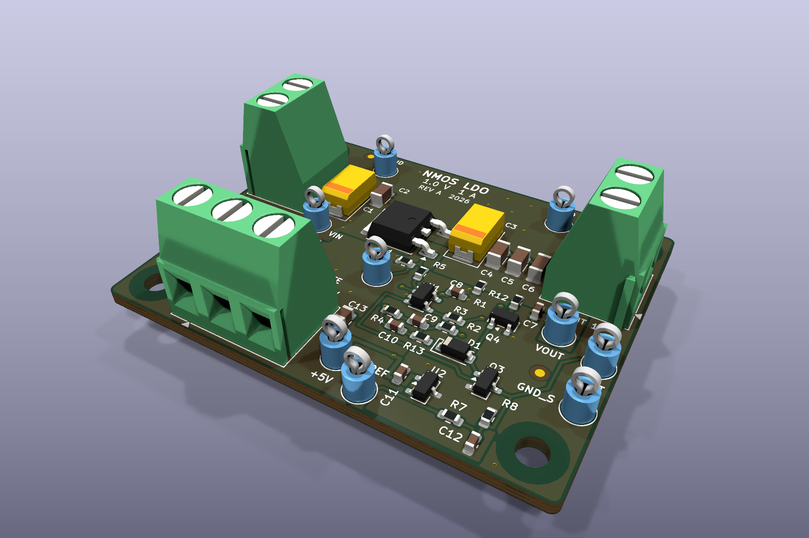
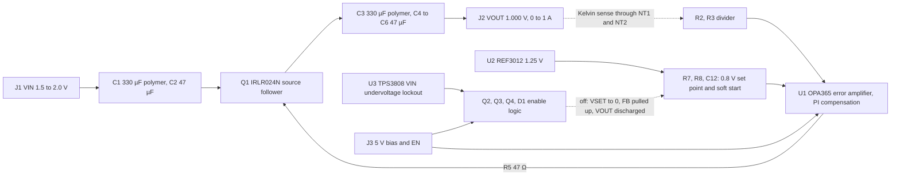
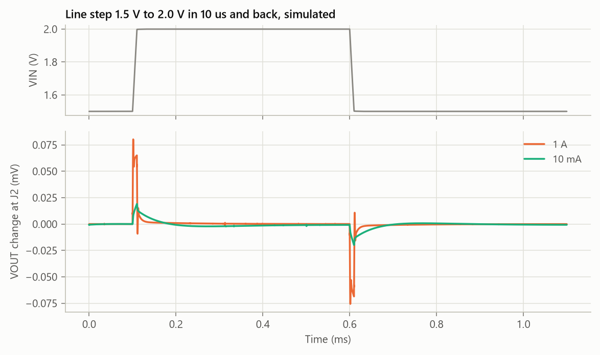
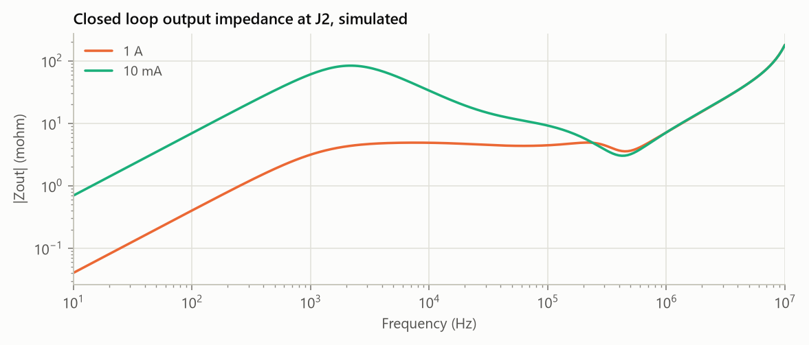
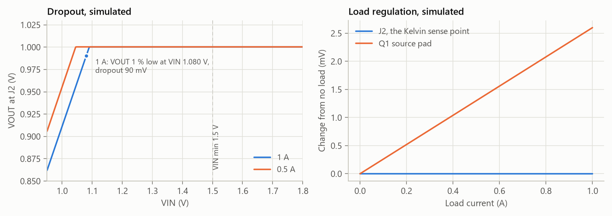
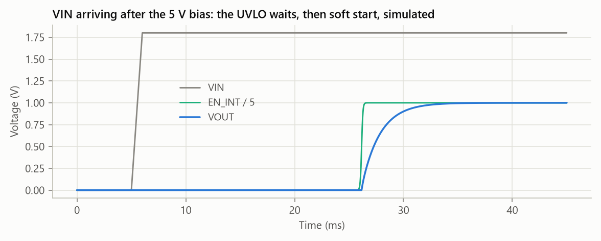

# NMOS LDO board: 1.0 V at 1 A from a 1.5 V to 2.0 V rail

This is a discrete low dropout regulator I designed for a low voltage core rail.
An N channel MOSFET runs as a source follower from a 1.5 to 2.0 V rail, 1.8 V nominal.
A separate 5 V bias supply powers the error amplifier and gives the gate enough headroom.
In simulation, the output holds 1.000 V at the load terminals from 0 to 1 A, with 90 mV of dropout at 1 A.

The repo has the full KiCad 10 design, the manufacturing files, and the ngspice and thermal simulations behind every performance number below.
All performance numbers are simulated. The thermal numbers come from a model of the routed copper.



| Top | Bottom |
|---|---|
|  |  |

## Key specs

Every value comes from `results/metrics.csv`, which `sim/run_all.py` writes. Every metric that has a target meets it.

| Parameter | Condition | Target | Simulated |
|---|---|---|---|
| Output voltage at J2 | VIN 1.8 V, 0.5 A | 1.000 V ±1 % | 1.0003 V |
| Initial accuracy, worst case | reference 0.2 %, resistors 0.1 %, op amp offset 200 µV | 0.990 to 1.010 V | 0.9969 to 1.0037 V |
| Load regulation at J2 | 0 to 1 A | ≤ 1 mV | 0.001 mV |
| Line regulation | VIN 1.5 to 2.0 V, at 0 A and 1 A | ≤ 1 mV | < 0.001 mV |
| Dropout | 1 A, VOUT 1 % low | ≤ 200 mV | 90 mV |
| Load step | 10 mA to 1 A and back at 1 A/µs | within ±30 mV | −8.7 mV / +7.4 mV |
| Line step | VIN 1.5 to 2.0 V in 10 µs and back, 1 A | within ±10 mV | 0.08 mV |
| PSRR from VIN | 1 kHz / 10 kHz / 100 kHz, 1 A | ≥ 60 / 40 / 30 dB | 99 / 81 / 63 dB |
| Phase margin | 0 A, 10 mA, 100 mA, 1 A | ≥ 45° | 59°, 79°, 108°, 81° |
| Worst phase margin | output capacitor ESR range and component corners | ≥ 45° | 56° |
| Worst gain margin | same sweeps | ≥ 10 dB | 29.6 dB |
| Soft start, 10 to 90 % | EN high, no load | 1 to 10 ms | 3.69 ms |
| Inrush current | no load | ≤ 0.5 A | 0.35 A |
| Peak VOUT at startup | EN first, or VIN last | ≤ 1.010 V | 1.0003 V |
| Q1 junction temperature | 1.00 W in Q1, 25 °C still air | ≤ 125 °C | 58 °C |
| 5 V bias current | 0.5 A load | report | 5.17 mA |

## How it works



- **Pass device.** Q1 is a logic level NMOS in DPAK. Its drain tab sits on the VIN copper and its source feeds the output capacitors.
- **Why NMOS with a bias rail.** A PMOS pass device on a 1.5 V rail only gets 1.5 V of gate drive, so its on resistance is high. The 5 V rail lets Q1 see up to 4 V of gate drive. The source follower also has no voltage gain and a low output impedance of 1/gm, so the plant has a single pole and the loop does not need capacitor ESR to be stable.
- **Error amplifier.** U1 is a rail to rail op amp on the 5 V rail. It compares the divided output with a 0.8 V set point and drives the gate through R5.
- **Kelvin sense.** The divider reads VOUT and ground at the J2 pads through net ties NT1 and NT2, so copper drop in the power path does not move the output.
- **Enable and UVLO.** EN on J3 and U3 both feed EN_INT. When either one is low, Q3 empties the soft start capacitor. D1 and R13 pull the feedback node up, so U1 drives the gate low, and Q4 discharges the output through 22 Ω. U3 starts its 20 ms delay once VIN rises past about 1.37 V and trips again below 1.345 V, so the output always comes up through soft start.

## Schematic


The PDF is in [`docs/schematic.pdf`](docs/schematic.pdf). Each block of the circuit has its own labeled section. The power path runs along the top, with the error amplifier and the reference below it. The bias, enable and UVLO circuit fills the bottom row.

## Design calculations

### Set point and divider

The reference is divided down to 0.8 V, and the feedback divider multiplies it by 1.25.

$$V_{SET} = 1.25\,\text{V} \cdot \frac{R_8}{R_7 + R_8} = 1.25 \cdot \frac{10\,\text{k}}{15.62\,\text{k}} = 0.8003\,\text{V}$$

$$V_{OUT} = V_{SET} \cdot \frac{R_2 + R_3}{R_3} = 0.8003 \cdot \frac{12.75\,\text{k}}{10.2\,\text{k}} = 1.0003\,\text{V}$$

R2, R3, R7 and R8 are 0.1 % thin film parts. With the 0.2 % reference and the 200 µV op amp offset, the worst case corners give 0.9969 V and 1.0037 V in simulation, inside the ±1 % target.

### Gate drive headroom

At 1 A the fitted Q1 model needs V_GS = 2.21 V, so the gate sits at about 3.21 V. U1 swings to 4.98 V into the 100 kΩ gate pull down, which leaves 1.77 V of headroom at full load. Near dropout the gate goes to the top of U1's swing and Q1 sees about 4 V of gate drive.

### Dropout

Dropout is the on resistance at about 4 V of gate drive times the load current, plus the copper. The fitted model gives 86 mΩ at 1 A, and the copper in the board netlist adds 3.6 mΩ.

$$V_{DO} = I_{LOAD} \cdot \left( R_{DS,on} + R_{copper} \right) \approx 1\,\text{A} \cdot \left( 86\,\text{m}\Omega + 3.6\,\text{m}\Omega \right) \approx 90\,\text{mV}$$

The datasheet limit is 110 mΩ at V_GS = 4 V and 9 A, so even a worst case part stays near 115 mV, well under the 200 mV target. At the 1.5 V minimum input there is 500 mV of headroom, more than five times the dropout. The simulation gives 90 mV at 1 A and 45 mV at 0.5 A.

### Soft start and reference filter

R7 and R8 also form the filter for the reference with C12.

$$\tau = \left( R_7 \parallel R_8 \right) \cdot C_{12} = 3.60\,\text{k}\Omega \cdot 0.47\,\mu\text{F} = 1.69\,\text{ms}$$

That puts the reference noise corner at 94 Hz. The 10 to 90 % rise is 2.2 τ = 3.7 ms and the time to 99 % is 4.6 τ = 7.8 ms. The simulation gives 3.69 ms and 7.8 ms. The steepest slope is 1.0 V / τ = 0.59 V/ms, which into 450 µF of output capacitance is 0.27 A of inrush. The simulation shows 0.35 A because the loop has to catch up once the gate passes threshold.

### Compensation and crossover

U1 runs as a PI controller. R4 and C9 set the proportional gain and the zero, and C10 adds a high frequency pole.

$$K_P = \frac{R_4}{R_2} = \frac{127\,\text{k}}{2.55\,\text{k}} = 50 \qquad f_Z = \frac{1}{2\pi R_4 C_9} = 1.25\,\text{kHz} \qquad f_P = \frac{1}{2\pi R_4 C_{10}} = 380\,\text{kHz}$$

The plant is the source follower driving the output capacitors. Its pole is at gm / 2π C_OUT, and gm grows with load current:

| Load | Q1 gm | Follower pole | Simulated crossover | Simulated phase margin |
|---|---|---|---|---|
| 0 A, 5 mA preload | about 0.09 S | about 30 Hz | 1.8 kHz | 59° |
| 10 mA | 0.17 S | 59 Hz | 4.2 kHz | 79° |
| 100 mA | 1.09 S | 380 Hz | 23.4 kHz | 108° |
| 1 A | 4.03 S | 1.4 kHz | 180 kHz | 81° |

At light load the integrator and the follower pole together bring the phase toward −180°. I put the PI zero at 1.25 kHz, just below the light load crossover, so it lifts the phase back to 59° there. R1 is a 5 mA preload, so gm never falls low enough to pull the crossover under the zero.

At full load the crossover lands where K_P times gm times the output capacitor impedance falls to one. With gm = 4 S and about 6 mΩ from the polymer ESR in parallel with the ceramics, that simple estimate lands near 200 kHz, and the simulation gives 180 kHz. The 380 kHz pole and the op amp poles are still far enough above it for 81° of margin. R5 isolates U1 from about 2 nF of gate capacitance in the model. Breaking the loop at the op amp output instead, which also catches the local loop through the compensation parts, gives 141° of margin.

### Thermal

The worst case loss is at the highest input and full load.

$$P_{Q1} = \left( V_{IN,max} - V_{OUT} \right) \cdot I_{LOAD} = \left( 2.0 - 1.0 \right) \cdot 1\,\text{A} = 1.00\,\text{W}$$

$$T_J = T_A + P_{Q1} \cdot R_{\theta JA} = 25\,^\circ\text{C} + 1.00\,\text{W} \cdot 32.4\,\text{K/W} \approx 57\,^\circ\text{C}$$

R_θJC is 3.3 K/W from the datasheet. The rest of R_θJA comes from the board model described below. The model gives 58 °C because U1 and R1 also heat the board with about 30 mW. In the model, with 35 % less surface cooling the junction reaches 68 °C, which still allows 82 °C ambient before the junction reaches 125 °C.

### Capacitors

- **Output.** One 330 µF polymer tantalum with 15 mΩ ESR holds the output during the first microseconds of a load step. Three 47 µF X5R 1206 parts add low ESL and low ESR at high frequency. I modeled each ceramic as 40 µF to allow for DC bias and tolerance at 1 V.
- **ESR is not needed for stability.** In simulation, the phase margin stays at 57° or more across 5 to 45 mΩ of polymer ESR and 1 to 10 mΩ per ceramic.
- **Load step estimate.** Going from 10 mA to 1 A, V_GS has to rise from 1.70 V to 2.21 V. With a proportional gain of 50, that takes about 10 mV of error at the output. The simulation gives −8.7 mV because the integrator and the output capacitors help.
- **Input.** C1, a second 330 µF polymer, and C2, a 47 µF ceramic, sit between J1 and the Q1 tab. The simulated load step includes 10 mΩ and 100 nH of input wiring, and the result does not change between 1.5 V and 1.8 V input.

## Simulation results

All plots are simulated. The data behind each one is in `results/data/`.

**Loop gain.** I break the loop at the Kelvin sense line and use Middlebrook's double injection, one run with a series voltage source and one with a shunt current source. This method holds even where the impedances on both sides of the break are similar.


**Phase margin against capacitor ESR.** The ceramic ESR only matters at full load.


The corner sweep moves the Q1 threshold by ±0.5 V, VIN from 1.5 to 2.0 V, the capacitors by their tolerance, the op amp output resistance, and the compensation parts. The worst phase margin is 56°, with the polymer capacitor 20 % high at 0 A. The worst gain margin is 29.6 dB, with the op amp output resistance at 20 Ω and a 1 A load.

**Load step and line step.**




**PSRR and output impedance.** Between 10 Hz and 1 MHz, PSRR is lowest at 355 kHz, where it is still 50 dB, and the output impedance peaks at 84 mΩ near 2 kHz with a 10 mA load. Above 1 MHz the capacitor ESL sets both curves.




**Dropout and load regulation.** The Q1 source pad rises 2.6 mV from 0 to 1 A because of the copper between Q1 and J2. The Kelvin sense removes it, so J2 moves by 0.001 mV.



**Soft start, enable and sequencing.** With EN already high and VIN arriving last, U3 holds the regulator off for 20.4 ms after VIN is good. Then the output ramps through soft start with no overshoot.




**Board temperature.** `sim/thermal.py` builds a four layer conduction model from the routed copper on a 0.25 mm grid. It includes every via barrel and the dielectric between the layers. Both faces lose heat by convection and radiation, and the Q1 junction ties to its tab through R_θJC. In the model, the 30 vias under and next to the Q1 tab keep the junction 6 °C cooler: 58 °C with them and 64 °C without.


## PCB

| | |
|---|---|
| Size | 54 × 42 mm, four M3 holes |
| Stackup | 4 layers, 1.6 mm, 35 µm copper on every layer |
| Top layer | parts, the VIN and VOUT power pours, the quiet GND_S pour, ground fill |
| Inner layers | In1 and In2 are solid ground |
| Bottom layer | the VIN heat spreader, ground fill, the Kelvin sense pair, the 38 mm EN_N line, a 26 mm GND_S run to TP10 and a few short jumpers |
| Checks | ERC 0 errors and 0 warnings. DRC with schematic parity gives 0 violations and 0 unconnected pads, both on the saved zone fill and after a fresh refill. Every check is on except length tuning |
| Outputs | Gerber X2, Excellon drill, fab notes, BOM with part numbers, pick and place, STEP, 3D renders |

Layout decisions:

- **Board size.** I aimed for 50 × 40 mm. The three terminal blocks, the four M3 holes and the straight power row needed 54 × 42 mm.
- **One straight power row.** J1, C1, C2, Q1, C3 to C6 and J2 sit in a line along the top edge. The power loop stays short and the control parts stay out of it.
- **Q1 heat path.** The tab sits on a 25 × 8 mm VIN pour on top. Thirty 0.3 mm vias under and next to the tab tie it to a 26 × 15 mm VIN pour on the bottom. The ground planes sit 0.21 mm under the top copper, so they spread heat across the whole board too. The 25 vias inside the tab pad are marked in [`fab/fab_notes.txt`](fab/fab_notes.txt) to be filled and capped, so solder does not wick into them.
- **Copper resistance from the layout.** `sim/pcb_parasitics.py` solves the copper as a resistor grid. J1 to the Q1 tab is 0.38 mΩ, the Q1 source to J2 is 2.54 mΩ, and the ground return is 0.46 mΩ. The board netlist uses these values, rounded up.
- **Kelvin sense.** NT1 and NT2 sit on the bottom layer right at the J2 pads. VOUT_S and GND_S leave the net ties side by side on the bottom layer and run to R2 and R3, so no load current flows in them.
- **Quiet ground.** U2, C11, R3, R8, C12 and Q3 return to GND_S, a separate copper island that meets the main ground only at J2. The set point does not see the ripple of the power ground.
- **Short gate drive.** U1, R5 and the compensation parts sit just below Q1, so the gate trace is short and the high impedance feedback node stays small.
- **Labels.** Each connector pin and test point carries its net name on the silkscreen, and no silkscreen text sits over a via. In the BOM the supply loops are red, the signal loops white and the ground loops black. The 3D model draws them all in one color.
- **Footprint pin maps.** I checked each symbol against its footprint. Q1 has its gate on pad 1, the drain on the tab and the source on pad 3. The BSS138, OPA365, REF3012 and TPS3808 pinouts match their SOT packages. The 1N4148W cathode band, the polymer capacitor anode, the terminal blocks and the test points also match.

I placed and routed the board in Python through KiCad's pcbnew API. Every footprint position, track, via and zone outline is written out in `scripts/build_pcb.py` and `scripts/route.py`, so the layout can be reviewed as text. `route.py` also finds room for the silkscreen labels, and KiCad fills the zones.

## Bill of materials

50 parts on 37 lines. The full list with manufacturer part numbers is [`fab/bom.csv`](fab/bom.csv).

| Ref | Part | Manufacturer | MPN |
|---|---|---|---|
| Q1 | N channel MOSFET, 55 V, 65 mΩ, DPAK | Infineon | IRLR024NTRPBF |
| U1 | 50 MHz rail to rail op amp | Texas Instruments | OPA365AIDBVR |
| U2 | 1.25 V reference, 0.2 % | Texas Instruments | REF3012AIDBZR |
| U3 | voltage supervisor, 0.405 V threshold | Texas Instruments | TPS3808G01DBVR |
| Q2, Q3, Q4 | small signal N channel MOSFET | onsemi | BSS138 |
| D1 | switching diode, 100 V, 300 mA, SOD-123 | Diodes Inc | 1N4148W-7-F |
| C1, C3 | 330 µF 6.3 V polymer tantalum, 15 mΩ | KEMET | T520D337M006ATE015 |
| C2, C4, C5, C6 | 47 µF 6.3 V X5R 1206 | Murata | GRM31CR60J476ME19L |
| R2, R3, R7, R8 | 0.1 % thin film, 0603 | Yageo | RT0603BRD07 series |
| J1, J2 | 2 pole screw terminal, 5.08 mm | Phoenix Contact | 1715721 |
| J3 | 3 pole screw terminal, 5.08 mm | Phoenix Contact | 1715734 |
| TP1 to TP10 | test loops | Keystone | 5005, 5006, 5007 |

## Repository layout

```
hardware/   KiCad 10 project: schematic, 4 layer board, ERC and DRC reports
fab/        Gerbers and drill files, the same set zipped, fab notes, BOM, pick and place, STEP model
docs/       schematic PDF and the images in this file
sim/        models, board netlist, and the Python that runs every analysis
results/    metrics.csv, plots, the data behind each plot, thermal model inputs
scripts/    Python that writes the schematic and the board and exports the outputs
```

## How to reproduce

The simulations need Python 3 with numpy, scipy, matplotlib and pillow, and the ngspice shared library. The copy that ships with KiCad works. Set `NGSPICE_LIBRARY_PATH` if it is not found.

```
python sim/run_all.py              # fits the Q1 model, runs every analysis, writes results/
python sim/pcb_parasitics.py       # copper resistance of the power paths from the layout
python scripts/export_outputs.py   # ERC, DRC, schematic PDF, Gerbers, drill, BOM, placement, STEP, renders
```

The design files themselves come from scripts. To rebuild them with KiCad 10:

```
python scripts/build_schematic.py
kicad-cli sch export netlist --format kicadsexpr -o hardware/nmos-ldo-board.net hardware/nmos-ldo-board.kicad_sch
python scripts/check_netlist.py hardware/nmos-ldo-board.net
<KiCad python> scripts/build_pcb.py
python scripts/make_project.py <KiCad>/share/kicad/demos/pic_programmer/pic_programmer.kicad_pro
kicad-cli pcb drc --refill-zones --save-board hardware/nmos-ldo-board.kicad_pcb
<KiCad python> scripts/export_copper.py
```

`make_project.py` has to run before the zone fill, because saving the board rewrites the project file with KiCad's defaults. After a rebuild, run the three commands above again, because `export_copper.py` changes the inputs of the thermal and copper models.

## Models and their limits

I wrote the Q1, U1, U2 and U3 models from datasheet numbers. The diode uses the commonly published 1N4148 parameters, and the BSS138 is a generic switch. No vendor model is used. Each model file lists the numbers it takes from the datasheet and the values it assumes.

| Part | Datasheet numbers used | Assumed or left out |
|---|---|---|
| IRLR024N | V_GS,th 1.0 to 2.0 V at 250 µA, set to 1.5 V. R_DS,on max at 10 V, 5 V and 4 V. Ciss, Coss and Crss at 25 V. Qgd, with Qg and gfs as checks. R_θJC 3.3 K/W | ngspice VDMOS fitted by least squares in `sim/fit_mosfet.py`, results in `results/model_check_irlr024n.csv`. Threshold corners at ±0.5 V. No temperature effects |
| OPA365 | 50 MHz GBW, 25 V/µs, 120 dB open loop gain, 4.6 mA supply current, about 10 mV swing to the rails, 200 µV offset, 65 mA short circuit current | 40 Ω output resistance, second pole at 90 MHz. No noise, CMRR or PSRR |
| REF3012 | 1.25 V, 0.2 % initial accuracy, 42 µA supply current, 1.8 V minimum supply | 0.5 Ω output resistance. No noise or drift |
| TPS3808G01 | 0.405 V SENSE threshold, 20 ms delay with CT open | 100 Ω pull down. No hysteresis |
| Capacitors | polymer 330 µF with 15 mΩ max ESR | ESL 2.5 nH for the polymer and 0.8 nH for the 1206 ceramics. Ceramics at 40 µF |
| BSS138, 1N4148W | BSS138 typical threshold 1.3 V. Standard 1N4148 diode parameters | switching function only |

Other limits:

- Every electrical model runs at 25 °C.
- Copper is lumped. Resistance comes from the layout. Inductance is an estimate for the path length over the plane.
- Each parasitic inductance has a 2 Ω damping resistor across it, which keeps the solver from ringing on nodes that only see inductors. Below 25 MHz it changes their impedance by less than 2 %.
- Q1's package inductance is left out. It resonates with the gate capacitance near 90 MHz, far above the loop.
- Transient runs use Gear integration with a 25 ns maximum step for the load step and 50 ns for the line step. Halving or doubling the step changes either result by less than 0.001 mV.
- The thermal model is steady state with a fixed surface coefficient: 14 W/m²K on top and 10 W/m²K underneath for a flat board in still air. It leaves out heat that leaves through the part bodies, the terminal blocks and the board edges, so it reads high.
