# NMOS LDO

A 1.0 V, 1 A low-dropout regulator built from a power NMOS and an op amp. Four-layer board in KiCad 10, simulated in ngspice.

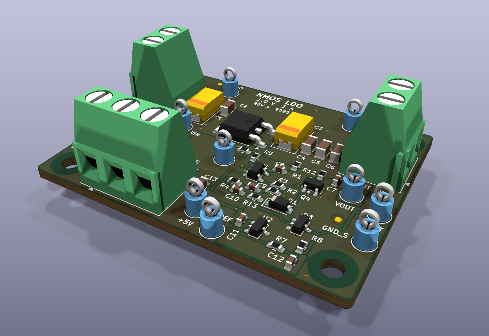

The target was 1.0 V at 1 A from a 1.5 to 2.0 V input with less than 200 mV of dropout. It ended up at 90 mV at 1 A. Everything here is simulated: ngspice for the circuit, and a small thermal model built from the board's copper.

| Top | Bottom |
|---|---|
| 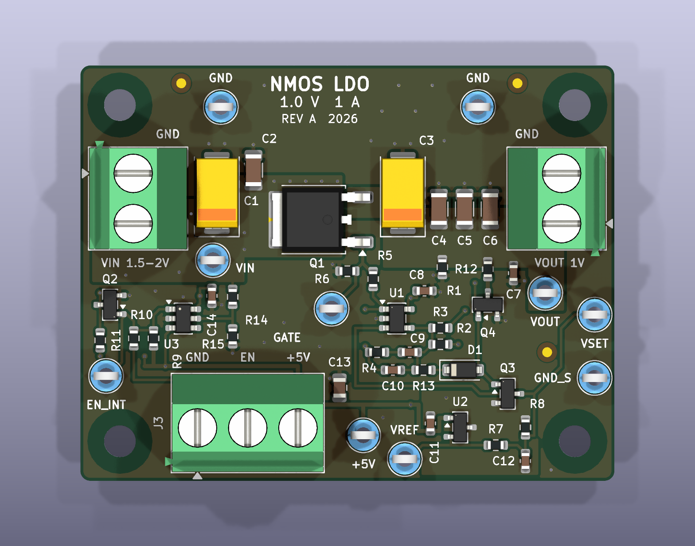 | 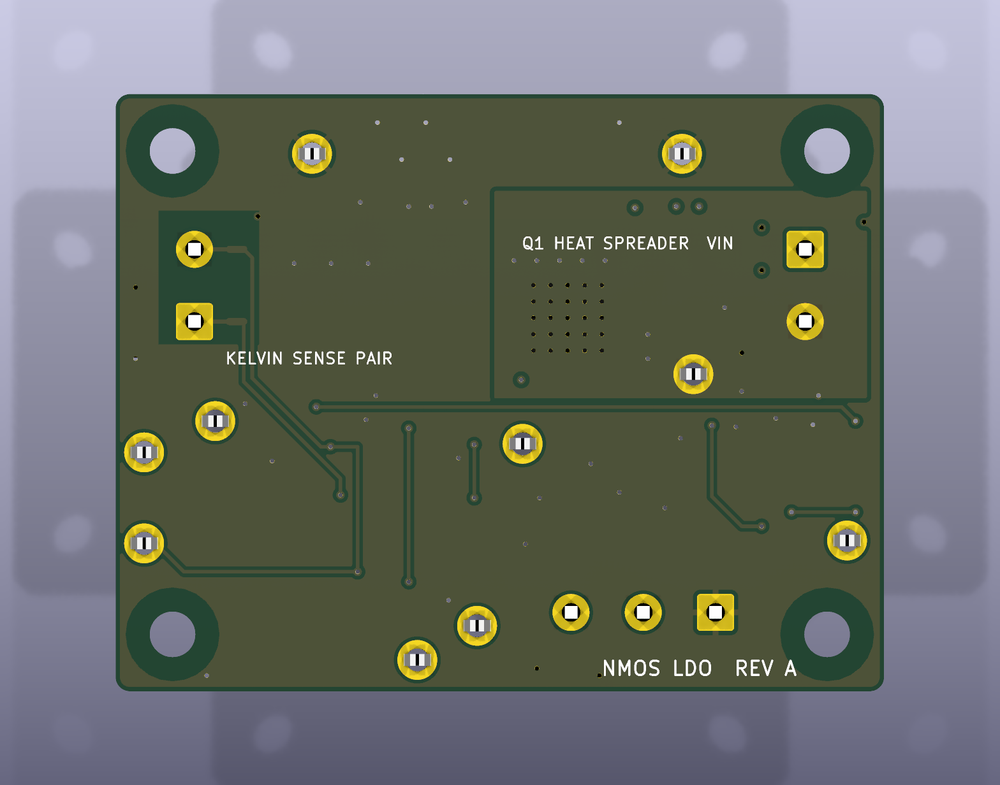 |

## How it works

The awkward part of a 1 V regulator is the gate drive. With a PMOS pass device the gate can only go down to ground, so on a 1.5 V input you only get about 1.5 V of V<sub>GS</sub> and the on-resistance gets ugly. I used an NMOS source follower instead and gave the error amp its own 5 V rail, so the gate can sit up to about 4 V above the source. Q1 is an IRLR024N in DPAK, which has plenty of margin at that drive.

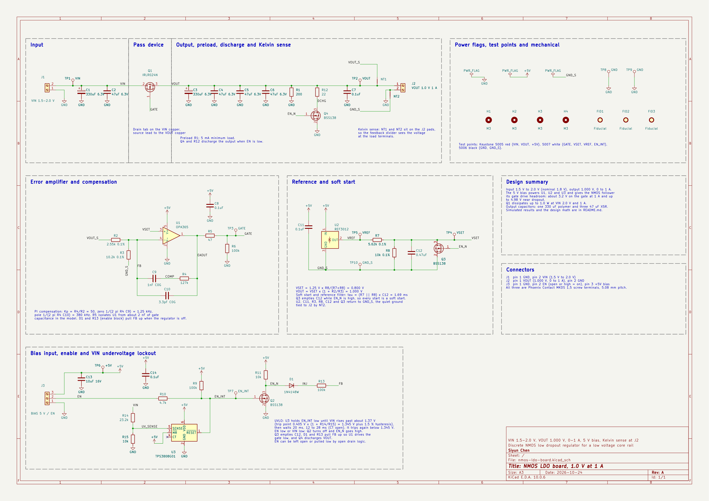

The error amp is an OPA365 running as a PI controller. A source follower is nice to compensate because it only adds one pole, but that pole moves a lot with load: about 30 Hz at no load and 1.4 kHz at 1 A. The crossover moves with it, from about 2 kHz up to 180 kHz. I put the PI zero at 1.25 kHz, just under the light-load crossover, and added a 5 mA preload so the pole can't drift any lower. Light load is where this circuit gets touchy, and the worst case I found over load, capacitor ESR and part tolerances was 56° of phase margin.

The rest is mostly housekeeping:

- The feedback divider reads the output right at the output terminal through two net ties, so the copper between Q1 and the terminal doesn't count. Q1's source moves 2.6 mV from 0 to 1 A, while the terminal moves 0.001 mV.
- A TPS3808 keeps the regulator off until VIN is above about 1.37 V, then waits 20 ms.
- Soft start is just an RC on the 0.8 V set point: 3.7 ms from 10 to 90%, with no overshoot.

## Simulation results

| | Target | Simulated |
|---|---|---|
| Output voltage | 1.000 V ±1% | 1.000 V |
| Dropout at 1 A | < 200 mV | 90 mV |
| Load step, 10 mA to 1 A in 1 µs | ±30 mV | −8.7 / +7.4 mV |
| PSRR at 1 / 10 / 100 kHz | 60 / 40 / 30 dB | 99 / 81 / 63 dB |
| Worst-case phase margin | > 45° | 56° |
| Soft start, 10 to 90% | 1 to 10 ms | 3.7 ms |
| Q1 junction at 1 W, 25 °C | < 125 °C | 58 °C |

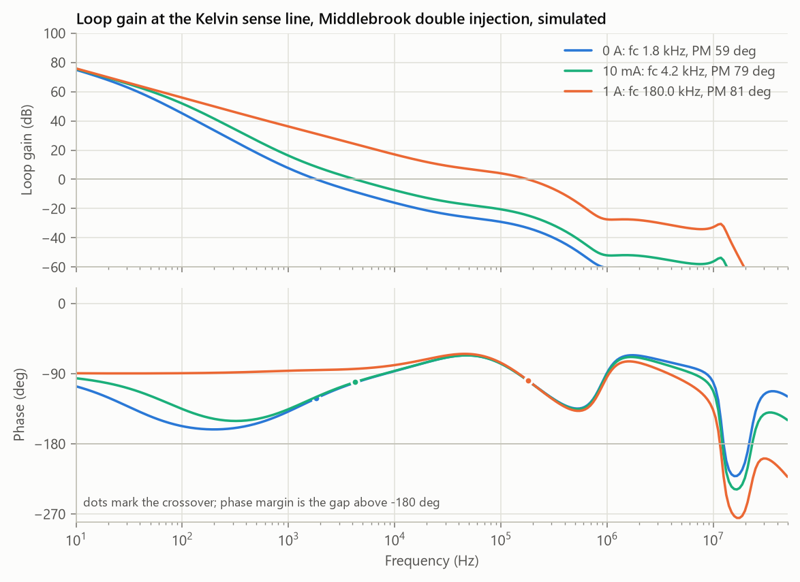

Loop gain at 0 A, 10 mA and 1 A. I broke the loop at the sense line and used Middlebrook's double injection, since the impedances on both sides of that node are close.

| | |
|---|---|
| 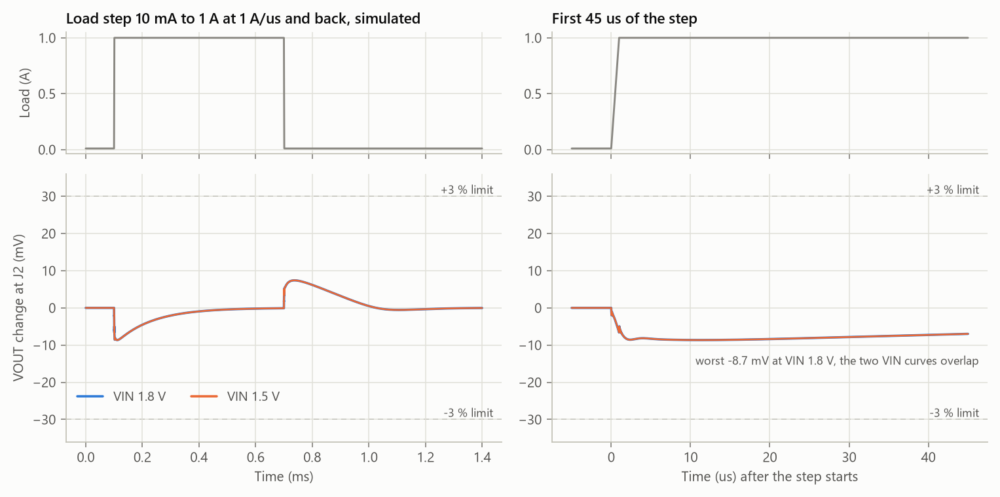 | 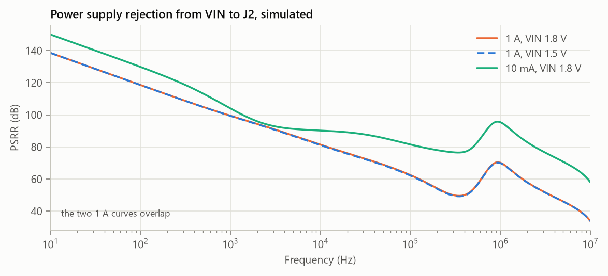 |
| Load step from 10 mA to 1 A at 1 A/µs. The output dips 8.7 mV and is back within 1 mV in about 0.3 ms. | PSRR from VIN. At 1 A the lowest point between 10 Hz and 1 MHz is 50 dB at 355 kHz. |
| 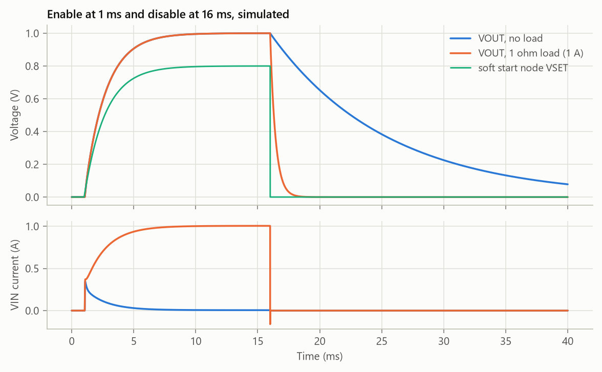 | 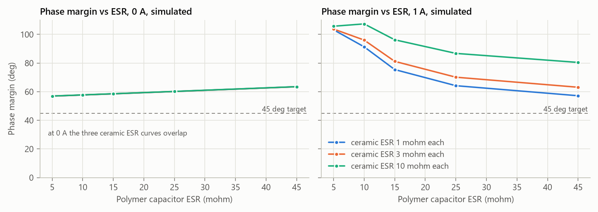 |
| Enable at 1 ms and disable at 16 ms, with no load and with a 1 Ω load. With no load the inrush peaks at 0.35 A while the output capacitors charge. | Phase margin against output capacitor ESR. It never drops below 57°, so the loop doesn't depend on ESR. |

## Layout

| Top copper | Bottom copper |
|---|---|
| 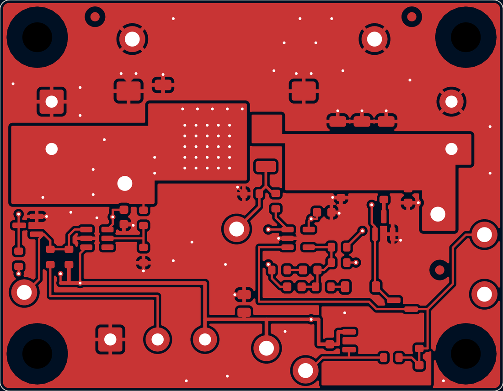 | 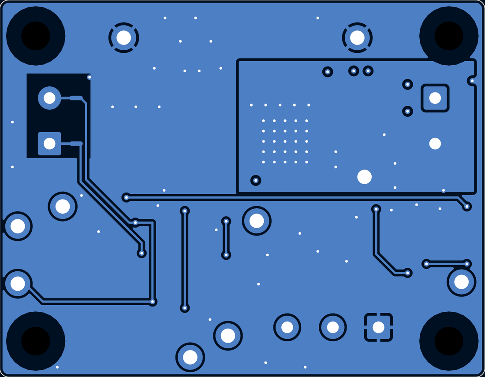 |

Four layers, 54 × 42 mm, with both inner layers as solid ground. I was aiming for 50 × 40 mm, but the three screw terminals and the M3 holes took more room than I expected.

- The power path is one straight line along the top edge: J1, C1 and C2, Q1, C3 to C6, J2. The control parts stay below it, out of the high-current loop.
- Q1's tab sits on a VIN pour with 30 vias down to a bigger pour on the bottom layer. In the thermal model those vias are worth about 6 °C: 58 °C with them, 64 °C without.
- The reference and the divider return to their own ground island, which only meets the main ground at the output terminal.

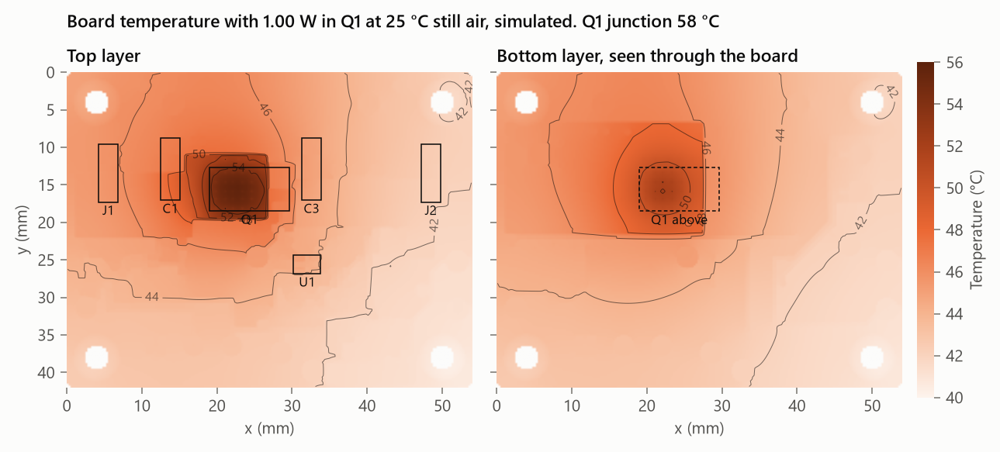

## Files

```
hardware/  KiCad project
fab/       Gerbers, drill, BOM, pick and place, STEP
sim/       ngspice models and the Python that runs each analysis
results/   plots, metrics.csv and the raw data behind each plot
scripts/   Python that generates the schematic and board files
docs/      design notes, schematic PDF and images
```

To rerun the simulations you need Python 3 with numpy, scipy, matplotlib and pillow, plus the ngspice shared library (the one that ships with KiCad works):

```
python sim/run_all.py
```

The hand calculations, the remaining plots, the part models and the rebuild steps are in [docs/design-notes.md](docs/design-notes.md).
